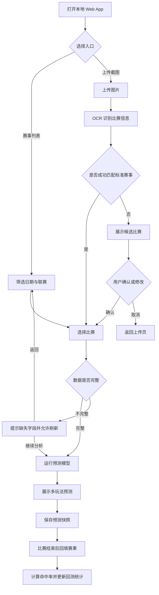

# 球赛智析：足球比赛预测本地 Web App PRD

版本：V1.0 MVP

状态：可进入技术设计与开发拆分

## 1. 产品概述

球赛智析是一款面向个人用户的本地 Web App。用户可以查看自动采集的足球赛事数据，也可以上传包含比赛信息的截图。系统通过 OCR 识别联赛、球队、比赛时间、让球信息和赔率，自动匹配标准赛事，再基于历史数据、球队状态、阵容信息和公开赔率生成多维度预测。

首要目标不是提供“保证正确”的结论，而是建立一套可持续回测、可解释、可比较的预测系统，逐步提高不同联赛和玩法上的预测准确率。

## 2. 目标与成功指标

### 2.1 产品目标

- 将截图中的比赛转换为标准化赛事记录。
- 自动收集并整理预测所需的公开数据。
- 输出胜平负、体彩让球、总进球、半全场和比分预测。
- 保存预测时点的数据快照，支持赛后自动复盘。
- 用真实历史结果评估模型，而不是只展示预测结论。

### 2.2 MVP 指标

- 图片赛事识别准确率：目标 ≥ 90%。
- 赛事自动匹配准确率：目标 ≥ 95%；无法确认时必须转人工确认。
- 关键数据字段完整率：有足够数据的比赛目标 ≥ 85%。
- 首次打开预测结果耗时：常规比赛目标 ≤ 10 秒，不含首次抓取。
- 所有预测记录均有生成时间、模型版本、数据来源和最终赛果。
- 上线初期只把“按玩法、联赛、时间段的命中率”作为观察指标，不承诺盈利或固定准确率。

## 3. 用户与使用场景

### 3.1 核心用户

个人足球数据研究用户，能够接受本地运行、数据刷新和模型结果存在不确定性，希望减少手工查数据时间，并持续验证模型表现。

### 3.2 典型场景

1. 用户上传一张体彩比赛截图，系统识别出比赛和让球信息，匹配公开数据后生成预测。
2. 用户打开今日赛事列表，筛选五大联赛和其他一级、二级联赛，批量查看预测结果。
3. 用户查看某个模型过去 30 天在英超“胜平负”玩法上的命中率，判断是否需要调整模型。
4. 比赛临近开赛时，用户刷新阵容、伤停和赔率，系统生成一版新的临场预测，并保留旧版本。

## 4. 产品范围

### 4.1 MVP 必须包含

```text
球赛智析
├── 仪表盘（核心）
│   ├── 今日/未来赛事
│   ├── 联赛和日期筛选
│   └── 数据刷新状态
├── 图片识别（核心）
│   ├── 上传图片
│   ├── OCR 识别
│   ├── 赛事匹配
│   └── 人工确认
├── 比赛分析（核心）
│   ├── 胜平负
│   ├── 体彩让球胜平负
│   ├── 总进球数
│   ├── 半全场
│   ├── 比分
│   └── 预测依据和置信度
├── 数据中心（核心）
│   ├── 公开数据源配置
│   ├── 手动刷新
│   ├── 抓取日志
│   └── 数据质量检查
├── 预测记录（重要）
│   ├── 历史预测
│   ├── 赛果回填
│   └── 命中率统计
└── 设置（重要）
    ├── 数据源
    ├── 模型版本
    ├── 默认联赛
    └── 本地备份与恢复
```

### 4.2 暂不包含

- 自动投注或任何资金操作。
- 用户注册、多人协作、社交功能。
- 付费数据源的绕过、破解或批量复制。
- 所有联赛一次性全量覆盖；先建立可配置的联赛目录。
- 复杂深度学习训练平台；MVP 使用可解释、易回测的统计模型。

## 5. 核心用户动线



## 6. 页面与布局

### 6.1 首页/仪表盘

```text
┌─────────────────────────────────────────────────────────────┐
│ 球赛智析       [今日] [赛事] [上传截图] [历史] [设置]         │
├──────────────┬──────────────────────────────────────────────┤
│ 筛选          │ 今日赛事                         [刷新数据]  │
│ 日期          │ ┌────────┐ ┌────────┐ ┌────────┐            │
│ 联赛          │ │ 英超   │ │ 西甲   │ │ 德甲   │            │
│ 比赛状态      │ │ 赛事卡 │ │ 赛事卡 │ │ 赛事卡 │            │
│ 玩法          │ └────────┘ └────────┘ └────────┘            │
│               │                                              │
│ 数据状态      │ 最近刷新：2026-07-21 12:00  数据完整率 88%    │
└──────────────┴──────────────────────────────────────────────┘
```

### 6.2 比赛分析页

```text
┌─────────────────────────────────────────────────────────────┐
│ 返回赛事列表   英超｜主队 vs 客队｜比赛时间   [重新预测]     │
├─────────────────────────────────────────────────────────────┤
│ 数据状态：完整度 92%  更新时间 10 分钟前  模型 v0.1.0       │
├───────────────────────────┬─────────────────────────────────┤
│ 球队状态/交锋/伤停/赔率     │ 预测结论                         │
│ 近期战绩、主客场、进失球     │ 胜平负：主胜 52% / 平 26% / 客胜 22%│
│ 阵容和数据来源               │ 让球：主队方向……                  │
│                             │ 总进球：2-3 球                   │
│                             │ 半全场：胜/胜                     │
│                             │ 参考比分：2:1、1:0               │
├───────────────────────────┴─────────────────────────────────┤
│ 预测依据：正向因素 / 风险因素 / 数据缺口                       │
└─────────────────────────────────────────────────────────────┘
```

## 7. 功能详细需求

### 7.1 赛事列表与筛选（P0）

功能描述：展示已采集的未来和近期比赛，并按日期、国家、联赛级别、比赛状态和数据完整度筛选。

触发条件：用户打开首页或点击“赛事”。

交互细节：默认显示未来 7 天；刷新时显示进度；无比赛时显示调整日期和联赛的引导；数据抓取失败时保留上次成功数据并标记过期。

状态：默认、加载中、加载成功、部分成功、失败、无结果、数据过期。

边界条件：重复比赛合并；时区统一为本地时区；球队改名或别名必须映射到同一标准球队；比赛取消或延期需要保留状态变化记录。

### 7.2 图片上传、OCR 与赛事匹配（P0）

功能描述：识别用户上传图片中的比赛信息，并将文本映射到标准赛事。

触发条件：用户点击“上传截图”并选择图片。

交互细节：支持 PNG、JPG、JPEG、WEBP；单张图片默认不超过 10 MB；上传后展示裁剪/旋转和识别中的状态；展示识别字段及置信度；匹配到唯一赛事时允许一键确认；有多个候选时按球队、时间、联赛相似度排序；失败时允许重新上传或手动录入。

识别字段：联赛名称、主队、客队、比赛日期、比赛时间、让球方、让球数、玩法、赔率。

状态：未上传、上传中、识别中、识别成功、低置信度、候选待确认、匹配成功、匹配失败、格式不支持。

边界条件：图片模糊、文字倾斜、队名被截断、同名球队、跨时区、比赛已结束、截图含多场比赛；任何无法确认的字段不得静默猜测。

数据规范：

| 字段 | 类型 | 必填 | 规则 |
|---|---|---:|---|
| image_id | UUID | 是 | 本地唯一标识 |
| file_name | string | 是 | ≤ 255 字符 |
| mime_type | enum | 是 | image/png、image/jpeg、image/webp |
| file_size | integer | 是 | 1 KB–10 MB |
| ocr_text | text | 否 | 保存原始识别文本 |
| ocr_confidence | decimal | 否 | 0–1 |
| recognized_matches | JSON | 否 | 识别出的比赛数组 |
| selected_event_id | UUID | 否 | 用户最终确认的赛事 |

### 7.3 公开数据采集与标准化（P0）

功能描述：从允许公开访问的数据来源采集比赛、球队、赛果、排名、近期状态、伤停、阵容和赔率等数据，并转换为统一格式。

触发条件：首次初始化、用户手动刷新、定时任务触发或预测前发现数据过期。

交互细节：用户可查看来源、抓取时间、成功/失败数量和缺失字段；支持单个赛事重抓；连续失败时退避重试；数据源不可用时不删除旧数据。

边界条件：来源页面结构改变、请求频率限制、重复数据、字段缺失、来源冲突、比赛延期、球队名称变化。采集器必须遵守数据来源的公开访问规则和服务条款，并保留来源链接或来源标识。

核心数据表：

| 表 | 关键字段 |
|---|---|
| leagues | id、country、name、tier、season、source |
| teams | id、league_id、name、aliases、country |
| events | id、league_id、home_team_id、away_team_id、kickoff_at、status |
| results | event_id、home_score、away_score、half_home_score、half_away_score |
| team_form | event_id、team_id、last_n_matches、goals_for、goals_against、home_away_split |
| injuries | event_id、team_id、player_name、status、impact、source_time |
| odds | event_id、market、handicap、selection、odds_value、captured_at、source |
| data_snapshots | event_id、captured_at、payload_hash、quality_score |
| predictions | event_id、model_version、generated_at、probabilities、recommendations、snapshot_id |
| prediction_results | prediction_id、actual_result、hit_status、evaluated_at |

### 7.4 预测引擎（P0）

功能描述：基于数据快照输出多个玩法的概率、推荐结果和风险说明。

MVP 建议采用可解释的组合模型：

- 进球期望：Poisson 或 Dixon-Coles 模型。
- 胜平负：基于主客队进球分布计算概率。
- 让球胜平负：将让球数纳入比分结果转换。
- 总进球：根据比分分布聚合为 0、1、2、3、4、5+ 等区间。
- 半全场：基于半场和全场进球分布计算 9 种组合概率。
- 集成校准：结合球队状态、阵容、主客场、联赛强度和赔率信息，并使用验证集校准概率。

模型结果必须保存完整概率分布，不只保存单一推荐。推荐规则由最大概率、最小置信度阈值和数据质量共同决定；低于阈值时显示“谨慎参考”，而不是强行推荐。

触发条件：用户打开分析页、点击重新预测、数据刷新完成或临场信息变化。

交互细节：显示模型版本、生成时间、输入数据时间点、数据完整度、概率和主要因素；模型运行失败时展示原因并允许使用上次结果；模型结果变化时标注变化字段。

状态：待运行、计算中、成功、低置信度、数据不足、失败、结果过期。

边界条件：没有历史样本、球队为新升班马、阵容信息缺失、赔率异常、比赛临近开赛、多个来源互相矛盾。遇到异常时降低置信度并记录原因。

### 7.5 历史回测与准确率（P0）

功能描述：使用历史比赛按时间顺序模拟预测，评估模型在不同联赛和玩法上的表现。

要求：严格避免未来数据泄漏；训练数据只能使用比赛发生前可获得的信息；区分训练集、验证集和测试集；每个模型版本可独立比较。

指标：命中率、对数损失、Brier Score、概率校准、覆盖率、低置信度比赛占比；如展示收益模拟，必须明确假设本金、赔率和投注规则，仅作为研究指标。

页面功能：按联赛、玩法、时间范围、模型版本筛选；查看混淆矩阵、概率分布、连续命中/失误、数据完整度与准确率关系。

### 7.6 赛后复盘（P1）

比赛结束后自动获取赛果，更新预测记录。若赛果未获取，允许用户手动补录，但必须标注“手动录入”。系统根据标准规则判断每个玩法是否命中，并将结果关联到预测生成时的数据快照。

### 7.7 本地设置、备份与恢复（P1）

- 配置数据源和刷新频率。
- 配置默认联赛、默认预测玩法和时间范围。
- 选择是否保留原始图片。
- 导出 JSON/CSV 数据备份。
- 从备份文件恢复，恢复前展示数据量并要求确认。
- 提供“删除所有本地数据”操作，必须二次确认。

## 8. 文案规范

### 8.1 产品风格

理性、克制、数据驱动，不使用“稳赚”“必中”“内幕”“保证准确”等表述。

### 8.2 面向用户的示例文案

- “模型倾向：主胜，但置信度一般。”
- “当前比赛缺少首发信息，结果仅供参考。”
- “已识别 3 场比赛，请确认球队名称。”
- “数据已更新至 12:30。”
- “该结果是概率分析，不代表确定赛果。”

### 8.3 面向开发的字段说明

使用稳定的英文字段名、枚举值和 ISO 8601 时间；展示层负责中文翻译。不要把界面文案直接作为数据库状态值。

## 9. 非功能性需求

### 性能

- 首页本地缓存最近一次赛事列表。
- 普通单场预测目标 ≤ 10 秒。
- 批量预测支持后台任务和进度显示。
- 抓取任务不能阻塞页面交互。

### 兼容性

- 支持 Chrome、Edge、Safari 的近两年版本。
- 适配桌面端和移动端浏览器。
- 图片识别失败时必须保留手动录入路径。

### 数据安全与隐私

- 默认仅绑定 localhost 或用户指定的本地网卡。
- 原始图片默认本地保存，可由用户关闭。
- 不上传个人图片和预测记录到第三方服务，除非用户主动配置外部 OCR/API。
- API 密钥使用本地环境变量或加密配置保存，不写入前端页面。
- 导出备份文件前提示其中可能包含图片识别文本和个人分析记录。

### 可维护性

- 采集器、标准化、预测模型、页面展示彼此解耦。
- 数据源适配器必须能独立替换。
- 每次模型变更生成新版本号，不覆盖旧预测。
- 所有抓取和预测任务写入可检索日志。

## 10. 推荐技术架构

```text
浏览器 UI
   │
   ├── 本地 API 服务
   │     ├── 赛事与数据查询
   │     ├── 图片上传与 OCR 任务
   │     ├── 赛事匹配服务
   │     └── 预测任务服务
   │
   ├── 数据采集层
   │     ├── 赛事/赛果适配器
   │     ├── 球队与联赛标准化
   │     ├── 赔率适配器
   │     └── 抓取缓存与重试
   │
   ├── 预测层
   │     ├── 特征生成
   │     ├── 基础统计模型
   │     ├── 概率校准
   │     └── 回测评估
   │
   └── 本地存储
         ├── SQLite：结构化数据
         ├── 文件目录：图片与备份
         └── 日志目录：抓取、模型和错误日志
```

推荐 MVP 采用 Python 后端、SQLite、本地任务队列和一个响应式 Web 前端。具体框架可在技术设计阶段根据现有代码库确定。

## 11. MVP 开发顺序

### 第 1 阶段：可运行闭环

1. SQLite 数据结构。
2. 手动导入赛事和赛果数据。
3. 赛事列表和比赛详情页。
4. 基于 Poisson/Dixon-Coles 的胜平负、总进球和比分预测。
5. 保存预测并录入赛果。
6. 基础命中率统计。

### 第 2 阶段：自动化数据与图片识别

1. 接入允许使用的公开数据源。
2. 数据源适配器和抓取日志。
3. 图片上传和 OCR。
4. 球队名称标准化和候选赛事匹配。
5. 让球和半全场预测。

### 第 3 阶段：准确率优化

1. 伤停、首发和赔率数据。
2. 时间切分回测。
3. 概率校准与模型版本对比。
4. 按联赛、玩法和数据质量分析误差。
5. 临场重新预测和预测版本对比。

## 12. 待确认与风险

- 需要最终选定可长期使用且允许自动访问的数据源；不同来源的字段和授权范围可能不同。
- 需要确定 OCR 使用本地模型，还是允许调用外部 OCR 服务。
- “五大联赛、各国一级和二级联赛”是产品目录范围，MVP 应采用分批启用，避免数据源和维护范围过大。
- 赔率数据可能存在时间差，必须展示采集时间，不能伪装成实时数据。
- 伤停、首发和低级别联赛数据可能不完整，系统必须降低置信度。
- 预测结果仅用于个人数据研究和分析，不构成投注建议或收益承诺。

## 13. MVP 验收标准

- 用户可以在本地启动 Web App 并看到赛事列表。
- 用户上传一张包含比赛的图片后，系统能展示识别字段和候选比赛。
- 用户确认比赛后，可以看到五类玩法的概率和推荐结果。
- 每条预测都能查看生成时间、模型版本、数据更新时间和数据质量。
- 比赛结束后可以录入赛果，并自动计算命中状态。
- 用户可以按联赛和玩法查看历史准确率。
- 数据抓取失败、图片无法识别、赛事无法匹配和数据不足时，都有明确的可恢复提示。
